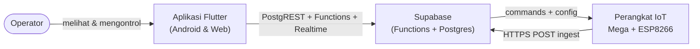
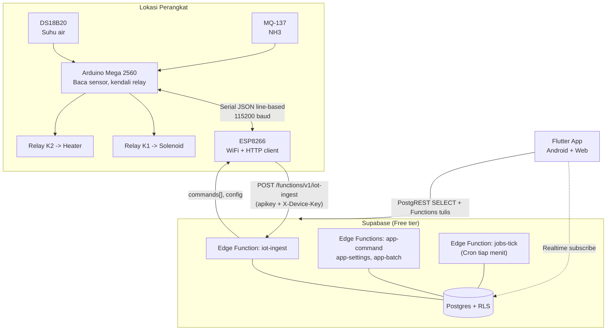

# 02 — System Architecture

> **Migrasi 2026-10-14 (Fase 8)**: backend Bun+Elysia+MySQL diganti
> **Supabase-only**. Server lama diarsipkan di
> `reference/archive/server-bun-2026-10-14/`. Rancangan migrasi:
> `17-SUPABASE-MIGRATION.md`.

## Gambaran Umum
Tiga lapisan utama: **Perangkat IoT** → **Supabase** → **Aplikasi**. Komunikasi
perangkat→Supabase memakai **HTTPS POST ke Edge Function** (kontrak sama
seperti REST lama agar firmware minim berubah). Aplikasi memakai PostgREST +
Edge Functions + Realtime (dengan fallback polling).

```
┌───────────────────────────┐   HTTPS POST /functions/v1/iot-ingest  ┌───────────────────────────┐
│        PERANGKAT IOT       │ ──────────────────────────────────────▶ │         SUPABASE          │
│  Arduino Mega + ESP8266    │ ◀────────────────────────────────────── │  Edge Functions (Deno)    │
│                            │   response: commands + config    │      │  Postgres + RLS           │
│  - DS18B20 (suhu air)      │                                  │      │  Realtime + Cron          │
│  - MQ-137  (gas NH3)       │                                  └──────┬────────────────────┘
│  - Relay K1 (katup)        │                                         │ PostgREST/Realtime/Functions
│  - Relay K2 (heater)       │                                         ▼
└───────────────────────────┘                                ┌──────────┴────────────────┐
                                                             │      APLIKASI FLUTTER     │
                                                             │   Android  +  Web         │
                                                             │  - Dashboard              │
                                                             │  - Grafik histori         │
                                                             │  - Kontrol katup/heater   │
                                                             │  - Notifikasi & pengaturan│
                                                             └───────────────────────────┘
```

## Diagram Konteks (C4 Level 1)



## Container Diagram (C4 Level 2)



## Alur Data

### Perangkat → Supabase
1. Mega membaca sensor tiap 2 detik, mengirim telemetry ke ESP via Serial.
2. ESP menyimpan nilai terbaru dan mengirim `POST /functions/v1/iot-ingest`
   tiap `ingest_interval` (default 10 detik) dengan header `apikey`,
   `Authorization: Bearer <publishable>`, dan `X-Device-Key`.
3. Function `iot-ingest` (service_role) menyimpan ke `latest_state`,
   mengevaluasi logika bisnis (matang, suhu, safety — porting 1:1 dari server
   lama), lalu membalas dengan daftar perintah tertunda + config terbaru.
4. ESP meneruskan perintah ke Mega; Mega mengeksekusi lalu mengirim ack.

### Supabase → Aplikasi
1. Aplikasi membaca `devices` + `latest_state` + `settings` (PostgREST) untuk
   live; subscribe Realtime `latest_state`, fallback polling 10 detik.
2. Aplikasi membaca tabel `events` untuk notifikasi (polling 30 detik +
   Realtime); tandai dibaca via UPDATE `is_read` (trigger guard).
3. Saat operator mengontrol, aplikasi invoke `app-command`; function mengantre
   `pending`; perintah diambil ESP pada ingest berikutnya.

### Mengapa Edge Function + PostgREST (bukan server sendiri)?
- Tanpa VPS/Docker/Caddy: TLS, backup, dan scaling milik Supabase.
- Kontrak ingest tidak berubah → firmware hampir tak tersentuh.
- RLS read-only + tulis tervalidasi di function = aman tanpa login.
- Trade-off: latensi kontrol bergantung interval ingest (sama seperti dulu;
   `poll_after_sec` mempercepat saat ada perintah).

## Komponen Backend (Supabase)
| Komponen | Tanggung jawab |
|---|---|
| **iot-ingest** (Deno) | Auth device, validasi, maturity/thermal/event, config+commands |
| **app-command/settings/batch** | Tulis tervalidasi (TTL, clamp, batas wajar) |
| **jobs-tick + Cron** | Sampling, offline-detector, command-expiry, retention |
| **Postgres + RLS** | 8 tabel (`supabase/migrations/`), anon SELECT, tulis service_role |
| **Realtime** | Subscribe `latest_state`/`events`/`commands` (opsional, fallback polling) |

## Komponen Aplikasi Flutter
| Komponen | Tanggung jawab |
|---|---|
| **Core** | Config (`SUPABASE_URL`/`PUBLISHABLE_KEY`), Supabase client, router |
| **Features** | Dashboard, History, Control, Notifications, Settings, Device |
| **Shared** | Widget & model umum |
| **State** | Riverpod (provider/notifier + polling + Realtime channel) |
| **Router** | go_router (bottom nav di mobile, rail di web) |
| **Charts** | fl_chart |

## Non-Functional & Deployment (ringkas)
- Tidak ada server untuk dirawat; deploy = `supabase functions deploy` + migrasi SQL.
- Aplikasi web & Android menunjuk project Supabase yang sama
  (`SUPABASE_URL` via `--dart-define`).
- Retensi `telemetry_raw` dikendalikan `jobs-tick` + `raw_retention_days`.

Lihat detail di `06`, `07`, `08`, `11`, `12`, `17`.
