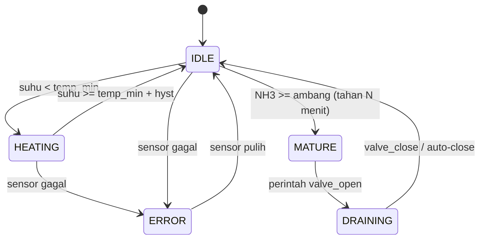

# 04 — IoT Firmware

## Pembagian Tugas
- **Arduino Mega 2560** — membaca sensor, mengendalikan relay, menjalankan logika
  suhu/heater & safety, lalu bertukar data dengan ESP8266 via Serial.
- **ESP8266** — jembatan jaringan: koneksi WiFi, HTTP client ke server,
  meneruskan perintah dari server ke Mega.

Pendekatan ini menjaga Mega tetap realtime (tidak terganggu WiFi) dan
memisahkan tanggung jawab dengan jelas.

## Struktur Kode
Dibangun dengan **PlatformIO** (tetap kompatibel Arduino IDE untuk berkas `.ino`).
Logika murni ditaruh di pustaka bersama `common/simohe_core` agar dapat diuji di
host tanpa hardware.

```
firmware/
├── common/
│   └── simohe_core/                 # pustaka logika bersama (Mega + ESP)
│       └── src/
│           ├── protocol.h/.cpp      # struct & enum protokol
│           ├── logic.h/.cpp         # state machine heater/katup/kematangan
│           ├── gas.h/.cpp           # Rs->ppm MQ-137 + filter rata-rata
│           ├── codec.h/.cpp         # encode/decode JSON frame
│           ├── time_parse.h/.cpp    # parse/format ISO-8601 UTC
│           └── simohe_core.h
├── mega/
│   └── simohe_mega/
│       ├── platformio.ini
│       ├── src/
│       │   ├── main.ino             # setup/loop non-blocking
│       │   ├── config.h             # pin, konstanta, default threshold
│       │   ├── sensors.h/.cpp       # DS18B20 + MQ-137
│       │   ├── actuators.h/.cpp     # relay katup & heater + safety
│       │   ├── config_store.h/.cpp  # EEPROM (config + R0)
│       │   └── bridge.h/.cpp        # protokol Serial3 ke ESP
│       └── test/test_logic/         # unit test native (Unity)
└── esp8266/
    └── simohe_esp/
        ├── platformio.ini
        ├── lib/simohe_esp_core/     # backoff, buffer offline, parser respons, ingest
        ├── src/
        │   ├── main.ino             # WiFi + HTTP client
        │   ├── config.h             # interval, pin LED, ukuran buffer
        │   ├── secrets.example.h    # salin ke secrets.h (gitignored)
        │   ├── credentials.h
        │   ├── wifi_manager.h/.cpp  # koneksi + backoff
        │   ├── api_client.h/.cpp    # HTTP ingest
        │   └── serial_bridge.h/.cpp # JSON Serial <-> HTTP payload
        └── test/test_logic/
```

### Rahasia/Kredensial
SSID/password WiFi, `server_base_url`, dan `device_key` **tidak** disimpan di
repo. Salin `firmware/esp8266/simohe_esp/src/secrets.example.h` menjadi
`secrets.h` lalu isi nilainya. `secrets.h` sudah masuk `.gitignore`;
`credentials.h` otomatis memakai `secrets.h` bila ada, jika tidak akan jatuh ke
`secrets.example.h` (nilai contoh) agar tetap dapat dikompilasi.

## Build & Flash (PlatformIO)
```bash
cd firmware/mega/simohe_mega && pio run -e mega            # kompilasi Mega
cd firmware/esp8266/simohe_esp && pio run -e esp           # kompilasi ESP
pio run -e mega -t upload                                  # flash (hardware)
pio run -e esp -t upload
```
Board Mega memakai `megaatmega2560`; ESP memakai `nodemcuv2` (sesuaikan bila
board berbeda, mis. varian Flash lebih kecil).

Pada board combo (RobotDyn MEGA+WiFi R3), atur DIP switch sebelum upload:
`3,4=ON` untuk Mega, lalu `5,6,7=ON` + tahan tombol Mode untuk ESP. Setelah
keduanya terpasang, set `1,2,3,4=ON` untuk mode jalan (Mega↔ESP di Serial3).
Rincian ada di `03-HARDWARE-AND-WIRING.md`.

## Library
- Mega: `OneWire`, `DallasTemperature`, `ArduinoJson` (v6).
- ESP8266: `ESP8266WiFi`, `ESP8266HTTPClient`, `ArduinoJson` (v6).
- Bersama: `common/simohe_core` (logika, codec, gas, waktu).

## Sensor Suhu — DS18B20
- Bus OneWire di pin 2, pull-up 4.7 kΩ.
- Resolusi 12-bit (±0.0625 °C) diset eksplisit; baca tidak lebih dari 1×/detik.
- Bila pembacaan `-127 °C` atau `85 °C`, anggap gagal; jangan pakai nilainya.
- Terapkan filter rata-rata bergerak (5 sampel) untuk meredam noise.
- **Diagnostik**: jumlah device (`getDeviceCount`) dicetak saat boot; bus dipindai
  ulang setiap 5 detik bila sensor tak terdeteksi, sehingga sensor yang terlepas
  lalu tersambung kembali dapat pulih tanpa reboot.

## Sensor Amonia — MQ-137
1. **Preheat**: 24–48 jam (minimal 24 jam) untuk stabilitas.
2. **Baca Rs**: `Rs = RL * (Vcc - Vout) / Vout` (RL modul, Vcc = 5V).
   `RL` saling hapus pada perhitungan ppm (karena `R0` memakai RL yang sama),
   sehingga hanya memengaruhi `Rs` absolut dan resolusi ADC.
3. **Kalibrasi R0** di udara bersih: `R0 = Rs_clean / ratio_clean`
    (ratio_clean ≈ 3.6 untuk NH3, sesuai datasheet).
    - **Otomatis sekali**: setelah warmup transient 30 detik
      (`MQ_CAL_WARMUP_MS`, hanya untuk stabilisasi boot — **bukan** pengganti
      preheat) dan `MQ_CAL_SAMPLES=15` sampel stabil
      (`spread<=0.2`, `MQ_CAL_MAX_SPREAD`), R0 dihitung lalu **disimpan ke
      EEPROM** (`r0Calibrated = true`) sehingga tidak kalibrasi ulang tiap boot.
    - **Kalibrasi ulang**: kirim `cal` lewat Serial0 (USB, saat `SIMOHE_DEBUG=1`).
      Pastikan sensor berada di udara bersih sebelum memicu. Kirim `status` untuk
      melihat jumlah device, `r0`, dan flag kalibrasi.
    - Nilai ppm difilter rata-rata 8 sampel (`PPM_FILTER_SIZE`) sebelum dipakai
      maturity/telemetri agar tidak jitter.
4. **Konversi ppm** (kurva power-law):
   `ppm = a * (Rs / R0) ^ b`
   dengan `a = 40.0`, `b = -4.106` (`config.h`) dari kurva datasheet MQ-137
   (40 ppm @ Rs/R0=1.0 dan 100 ppm @ Rs/R0=0.8). Nilai bersifat estimasi;
   verifikasi di lapangan.
5. Catat bahwa MQ-137 punya **cross-sensitivity** (gas lain bisa memengaruhi);
   nilai ppm adalah estimasi.

> Nilai `a`, `b`, `R0`, dan `RL` ditetapkan sebagai konstanta yang dapat
> disetel (`config.h` / EEPROM), bukan angka sihir di tengah kode.

## Logika Heater (di Mega)
```
mode: AUTO | FORCE_ON | FORCE_OFF (FORCE_ON punya deadline)

setiap loop:
  baca suhu
  if mode == AUTO:
     if suhu < temp_min:            heater = ON
     if suhu >= temp_min + hyst:    heater = OFF
  if mode == FORCE_ON and now < deadline: heater = ON
  if mode == FORCE_ON and now >= deadline: mode = AUTO

  # Safety (selalu menang, edge-trigger — event hanya saat transisi)
  if suhu >= temp_max:             heater = OFF, kirim event SAFETY_CUTOFF
  if heater ON terus > heater_max_on_ms: heater = OFF + cooldown 10 mnt, kirim event SAFETY_CUTOFF
```
- `temp_min` default 30 °C, `hyst` 2 °C, `temp_max` 45 °C.
- Heater tidak pernah ON saat sensor suhu gagal dibaca (fail-safe).
- Setelah `heater_max_on`, heater di-latch OFF selama `kHeaterCooldownMin=10`
  menit agar tidak langsung nyala lagi loop berikutnya. Durasi `heater_on`
  di-clamp `1..heaterMaxOnMin` (maks global 1440 menit).

## Logika Kematangan (di Mega, dilaporkan ke server)
Mega menghitung estimasi ppm dan mengirimkannya. **Keputusan matang yang
otoritatif ada di server** (karena butuh durasi & histori). Mega tetap dapat
mengirim sinyal awal:
```
if nh3_ppm >= nh3_mature_ppm:
   mature_timer += dt
else:
   mature_timer = 0

if mature_timer >= mature_hold_ms: tandai "siap matang" (laporan)
```
- Katup **tidak** dibuka oleh logika ini.

## Logika Katup (di Mega)
```
katup hanya berubah karena perintah dari ESP/server:
  CMD_VALVE_OPEN  -> relay K1 = ON, mulai valve_max_open_ms timer
  CMD_VALVE_CLOSE -> relay K1 = OFF
  if katup terbuka > valve_max_open_ms: tutup paksa + event SAFETY
```

## State Machine (ringkas)



## Loop Non-Blocking
- **Tidak** memakai `delay()` panjang. Gunakan `millis()` untuk:
  - pembacaan sensor (tiap 2 detik),
  - heartbeat/telemetry ke ESP (tiap 2 detik),
  - timer heater & katup.
- Kirim telemetry ke ESP setiap 2 detik atau saat status berubah (edge-triggered).

## Konfigurasi
- Nilai default tersimpan di `config.h`. Semua config dari server/EEPROM lewat
  `sanitizeHeaterConfig()` (tolak `NaN/Inf`, `tempMin<tempMax`, clamp
  `1..1440` menit, `1..3600` detik ingest).
- Konfigurasi dari server (`settings`) dikirim melalui ESP dan diterapkan Mega;
  salinan disimpan di EEPROM agar tahan restart. EEPROM v2 ber-CRC16 dan tulis
  hanya bila berubah (`saveIfChanged`) agar hemat siklus ~100rb tulis.
- ESP memegang: SSID/password, `server_base_url`, `device_key`,
  `ingest_interval_sec`. Perbandingan config pakai epsilon float agar tidak
  kirim ulang tiap ingest.

## Ketahanan (Resilience)
- **WiFi putus**: ESP reconnect dengan backoff eksponensial (mis. 2s, 4s, 8s…,
  maks 60s) dan menyalakan indikator. Penjadwalan pakai `timeReached()`
  agar aman `millis()` overflow 49 hari.
- **Server tak terjangkau**: ESP menyimpan 8 frame ingest penuh
  (`8x1024=8KB`) dan kirim ulang maks 5/ingest saat tersambung; sampel terlama
  dibuang saat penuh. Frame yang tidak muat utuh ditolak (tidak di-truncate).
  Respons replay **tidak** dipakai untuk update config/waktu/perintah (anti basi).
  `400` tidak di-buffer (anti poison queue), `429/5xx` di-buffer + backoff.
- **Serial rusak/JSON tidak valid**: abaikan baris, jangan blok. Baris overlong
  (>511 char) dibuang utuh sampai `\n` (tidak di-split jadi frame palsu).
  `mode`/`id`/`action` invalid ditolak; `time` pendek/kosong ditolak tanpa OOB-read.
- **Buffer Serial**: pada AVR, buffer RX/TX bawaan (64B) mudah meluap saat ESP
  mengirim beberapa frame berurutan. Kedua target memakai `build_flags`
  (`SERIAL_RX_BUFFER_SIZE=256`/`SERIAL_TX_BUFFER_SIZE=256`), dan ESP hanya mengirim
  `config` saat nilainya berubah.
- **Watchdog**: aktifkan WDT pada Mega & ESP; restart bila hang.
- **Heartbeat**: ESP menyertakan uptime; server menandai perangkat offline bila
  tidak ada ingest melebihi ambang (mis. 3× interval ingest).

## Perintah (dari server ke Mega)
1. ESP menerima `commands[]` sebagai respons `POST /api/iot/ingest`.
2. ESP mengubahnya menjadi frame Serial JSON dan mengirim ke Mega. Perintah
   ber-expiry ditunda bila waktu belum sync; yang kedaluwarsa dibuang.
   `id`/`action` terpotong ditolak agar `ack` tetap cocok.
3. Mega mengeksekusi, lalu membalas `ack` berisi `id` perintah.
4. ESP meneruskan ack ke server pada ingest berikutnya (field `acks[]`).
5. Perintah yang melewati TTL dianggap `expired` dan diabaikan. Mega tidak punya
   RTC sehingga mengandalkan filter expiry di ESP (lihat `docs/09`).

## Pengujian Firmware
Firmware diuji **tanpa hardware** melalui dua lapis:
1. **Kompilasi** kedua target PlatformIO (`pio run -e mega`, `pio run -e esp`).
2. **Unit test logika di host** (`pio test -e native`), memakai Unity dan
   ArduinoJson di `common/simohe_core` + `simohe_esp_core`. Cakupan: state
   machine heater/safety, auto-close katup, kematangan, konversi Rs→ppm,
   filter rata-rata, encode/decode JSON, parser respons, buffer offline, dan
   backoff.

Pengujian **bench per komponen** dan **HIL** (DS18B20 vs termometer, kalibrasi
MQ-137, relay, Serial Mega↔ESP, fail-safe) memerlukan hardware dan dilakukan di
**Fase 6** (lihat checklist HIL di `13-TESTING.md`). Device simulator
(`server/tools/simulator/`) tetap dipakai untuk menguji server & aplikasi.
