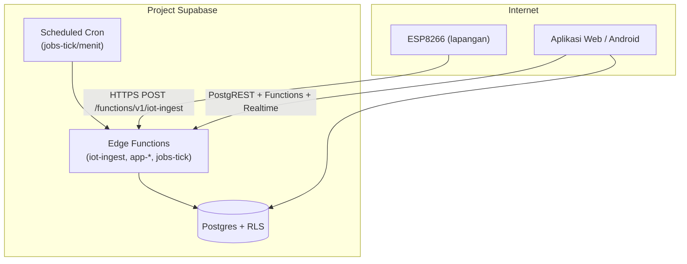

# 12 — Deployment

> **Migrasi 2026-10-14 (Fase 8)**: Docker Compose + Caddy + MySQL host
> dihapus. Deploy = Supabase dashboard + CLI. Rencana lama diarsipkan di
> `reference/archive/server-bun-2026-10-14/` (Dockerfile, compose, Caddyfile).
> Langkah klik-per-klik: `supabase/SETUP.md`.

## Target
- Backend: project Supabase (Postgres + 5 Edge Functions + Cron).
- Aplikasi Flutter: Android (APK), Web (static hosting).
- Perangkat ESP8266 menunjuk `https://<ref>.supabase.co`.

## Topologi



## Alur Deploy (ringkas)
1. Buat project Supabase (region Singapore) + catat URL & publishable key.
2. Jalankan `supabase/migrations/0001_init.sql` + `0002_events_read.sql`.
3. Jalankan `supabase/seed.sql` (ganti hash device key).
4. Set secrets: `SUPABASE_SERVICE_ROLE_KEY` (+ opsional `APP_WRITE_KEY`).
5. Deploy functions:
   ```bash
   supabase link --project-ref <ref>
   supabase functions deploy iot-ingest app-command app-settings app-batch jobs-tick
   ```
6. Daftarkan cron (`supabase/cron.sql`, perlu ekstensi pg_cron + pg_net).
7. Uji via `supabase/tools/sim-curl.sh` (lihat `supabase/SETUP.md` §7).
8. Isi `secrets.h` ESP (URL + publishable key + device key), flash.
9. Build Flutter dengan `--dart-define=SUPABASE_URL/PUBLISHABLE_KEY`:
   ```bash
   flutter build apk --dart-define=SUPABASE_URL=... --dart-define=SUPABASE_PUBLISHABLE_KEY=...
   flutter build web --dart-define=SUPABASE_URL=... --dart-define=SUPABASE_PUBLISHABLE_KEY=...
   ```

## Database & Backup
- Backup harian di Dashboard → Database → Backups (retensi ikut tier).
- Ekspor berkala tabel penting via SQL Editor bila perlu arsip sendiri.
- `jobs-tick` membersihkan `telemetry_raw` sesuai `raw_retention_days`.

## Mode Pengembangan Lokal
- Tanpa server lokal: app + sim-curl langsung ke project Supabase (dev).
- Atau project Supabase kedua khusus staging.

## Operasional
- Log: Dashboard → Edge Functions → Logs; cron: `select * from cron.job_run_details`.
- Health: panggil `jobs-tick` manual / cek `latest_state.updated_at` —
  alert bila beku (cron mati) atau device offline.

## CI/CD (opsional, fase lanjut)
- `flutter analyze` + `flutter test` + `pio test` saat push (GitHub Actions).
- Deploy functions otomatis via `supabase` CLI.
- Build APK/Web artefak.
