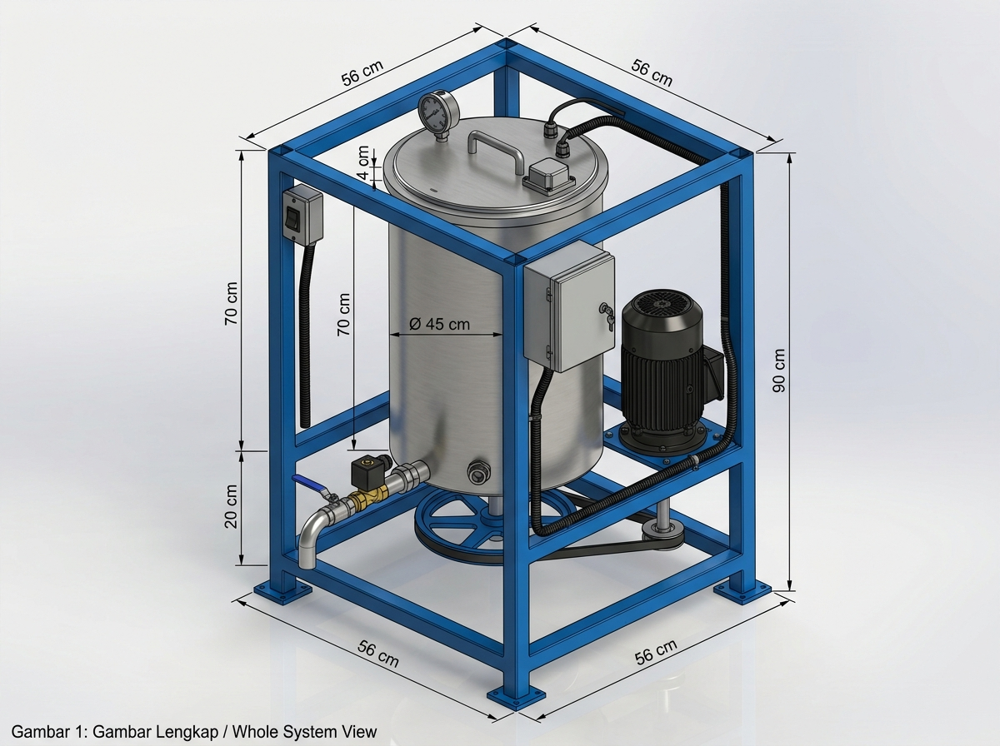
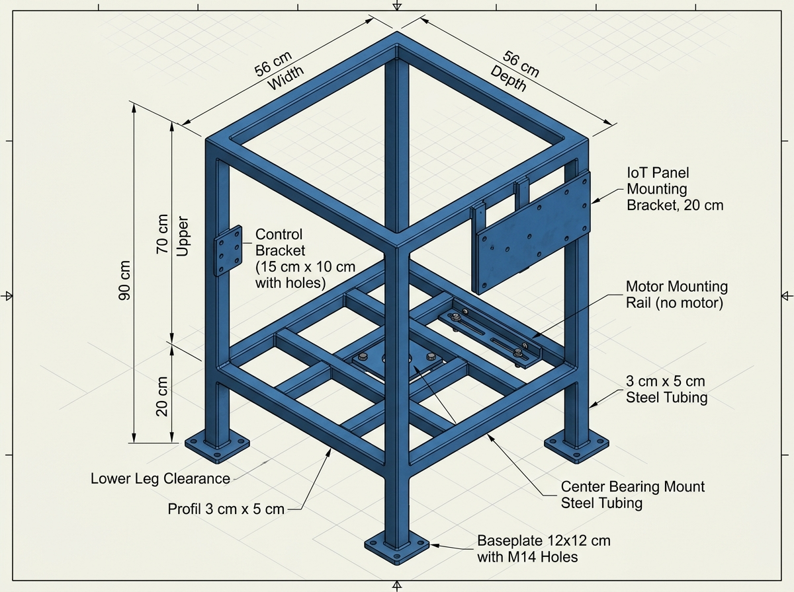
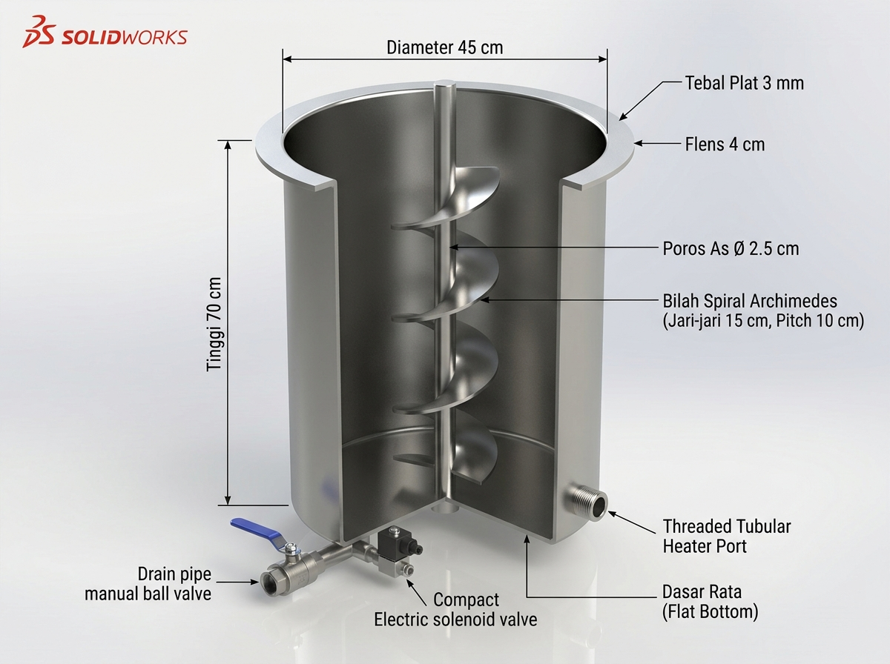
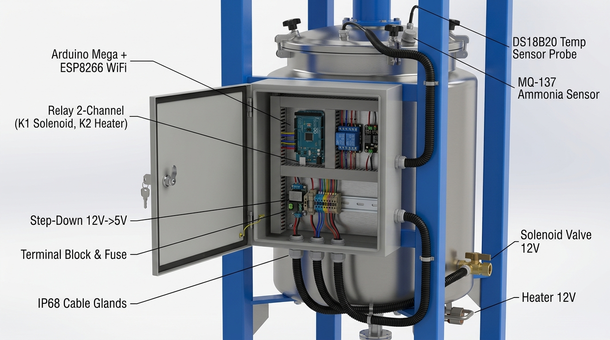
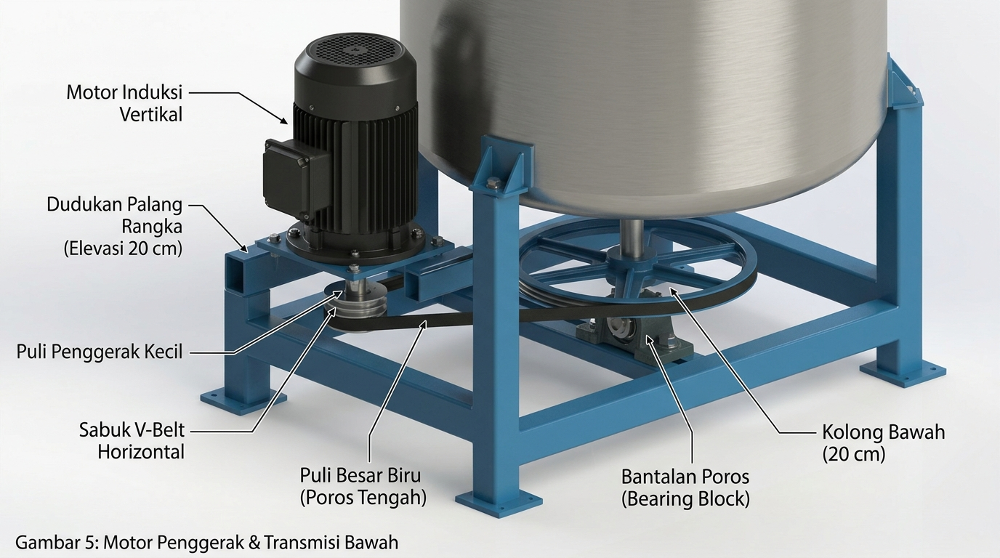

# Cetak Biru & Visualisasi Teknis Mesin Pengaduk SIMOHE

Dokumen ini merangkum rancangan cetak biru (*blueprint*), dimensi struktural, spesifikasi material, skema perkabelan elektrikal/IoT, dan visualisasi teknis 3D CAD untuk **Mesin Pengaduk (*Mixer/Agitator*) Bioproses Kotoran Hewan (KOHE) Berbasis IoT**.

Rancangan ini disusun berdasarkan data referensi bengkel, foto mesin fisik riil, coretan sketsa dimensi teknis di folder [`File mentah bahan/`](./File%20mentah%20bahan/), citra acuan desain kasar ([`referensi_desain_kasar.jpg`](./referensi_desain_kasar.jpg)), serta spesifikasi perangkat keras pada [`docs/03-HARDWARE-AND-WIRING.md`](../03-HARDWARE-AND-WIRING.md).

---

## 1. Daftar 5 Visualisasi Teknis 3D CAD

Berikut adalah 5 visualisasi teknis 3D CAD resolusi tinggi yang dihasilkan sesuai tata letak presisi dan spesifikasi teknis:

| No | Komponen Visualisasi | File Gambar | Deskripsi Inti & Fitur |
|:---:|---|---|---|
| **1** | **Gambar Lengkap Mesin (*Whole System View*)** | [`01_gambar_lengkap_mesin.jpg`](./01_gambar_lengkap_mesin.jpg) | Keseluruhan unit mesin: rangka biru $56 \times 56 \times 90\text{ cm}$, tabung silinder stainless dasar datar, motor induksi vertikal duduk di palang bawah, boks IoT abu-abu, katup solenoid 12V & ball valve, port heater 12V, serta label dimensi lengkap. |
| **2** | **Gambar Rangka Struktural (*Structural Frame Only*)** | [`02_gambar_rangka_mesin.jpg`](./02_gambar_rangka_mesin.jpg) | Rangka profil baja $3\text{ cm} \times 5\text{ cm}$ warna biru industri. Dimensi luar $56 \times 56\text{ cm}$, tinggi $70\text{ cm} + 20\text{ cm}$ kolong kaki, grid palang penopang bawah, dudukan bearing tengah, dan dudukan rel motor. |
| **3** | **Gambar Tabung & Pengaduk Spiral (*Vessel & Spiral Agitator*)** | [`03_gambar_tabung_tanpa_tutup.jpg`](./03_gambar_tabung_tanpa_tutup.jpg) | Tabung stainless 304 tebal $3\text{ mm}$ ($\varnothing 45\text{ cm} \times 70\text{ cm}$), dasar **RATA/DATAR (*flat bottom*)**, flens $4\text{ cm}$, potongan *cutaway* memperlihatkan poros as $\varnothing 2.5\text{ cm}$ & bilah spiral Archimedes (jari-jari $15\text{ cm}$, pitch $10\text{ cm}$). |
| **4** | **Gambar Sistem IoT & Wiring (*IoT Architecture & Wiring View*)** | [`04_gambar_sistem_iot.jpg`](./04_gambar_sistem_iot.jpg) | Interior boks panel IP65 terbuka: Arduino Mega + ESP8266 WiFi, Relay 2-Channel (K1 Solenoid, K2 Heater), Step-Down 12V $\to$ 5V, Terminal Block & Fuse, jalur kabel ke DS18B20 & MQ-137 di tutup atas, serta ke Solenoid & Heater di bawah. |
| **5** | **Gambar Motor & Transmisi Bawah (*Drive & Pulley Mechanism*)** | [`05_gambar_motor_dan_poros_pengaduk.jpg`](./05_gambar_motor_dan_poros_pengaduk.jpg) | *Close-up* transmisi kolong $20\text{ cm}$: Motor listrik vertikal duduk di atas palang rangka bawah, puli penggerak kecil, sabuk V-belt horizontal, puli besar ruji biru di bawah dasar tabung, dan bantalan poros (*bearing block*). |

---

## 2. Rincian Teknis & Visualisasi Tiap Komponen

### 2.1 Gambar 1 — Gambar Lengkap Mesin (Whole System View)

* **Fungsi**: Memberikan visualisasi isometrik menyeluruh dari seluruh unit mesin saat siap dioperasikan di lapangan.
* **Fitur Utama Sesuai Spesifikasi**:
  * **Rangka Penyangga**: Besi hollow/siku warna biru industri profil $3\text{ cm} \times 5\text{ cm}$ dengan ukuran luar $56\text{ cm} \times 56\text{ cm} \times 90\text{ cm}$ (tinggi sangkar utama $70\text{ cm}$ dan kolong bawah kaki $20\text{ cm}$). Dilengkapi 4 pelat tapak kaki (*baseplate*) yang menempel di lantai.
  * **Tabung Stainless Steel**: Silinder vertikal diameter luar $\varnothing 45\text{ cm}$, tinggi $70\text{ cm}$, tebal dinding pelat $3\text{ mm}$, dengan bibir flens atas $4\text{ cm}$ dan dasar tabung **RATA/DATAR (*flat bottom*)**.
  * **Tutup Hermetis Atas**: Dilengkapi gagang (*handle*) tengah, manometer analog (*pressure gauge*), boks sensor gas amonia (MQ-137), dan gland kabel probe sensor suhu air (DS18B20).
  * **Motor Penggerak Bawah**: Motor listrik induksi hitam dipasang **BERDIRI VERTIKAL** (tutup kipas menghadap ke atas, poros ke bawah), duduk kokoh di atas palang horizontal rangka biru pada ketinggian $20\text{ cm}$ dari lantai (sejajar dengan dasar tabung). Motor memiliki celah aman terhadap dinding tabung stainless.
  * **Transmisi Kolong Bawah ($20\text{ cm}$)**: Poros motor menembus ke kolong bawah memutar puli kecil, dihubungkan oleh V-belt karet hitam horizontal ke puli besar roda ruji biru di bagian tengah bawah.
  * **Drainase Bawah Depan**: Pipa outlet stainless dilengkapi keran manual *ball valve* bertuas biru dan katup elektrik **Solenoid Valve 12V DC** (badan kuningan/koil hitam), berakhir pada pipa *elbow* 90° mengarah ke bawah.
  * **Port Pemanas (*Heater*)**: Elemen pemanas 12V DC terpasang pada port dinding samping bawah tabung.
  * **Panel Kontrol IoT & Jalur Konduit**: Boks abu-abu IP65 terkunci di tiang vertikal kanan depan, saklar ON/OFF motor di tiang kiri depan, serta selang fleksibel konduit hitam bercabang rapi menuju sensor di tutup atas dan aktuator di bagian bawah.
  * **Anotasi Dimensi CAD**: Menampilkan garis ukur dimensi utama ($56\text{ cm}$, $70\text{ cm}$, $20\text{ cm}$, $90\text{ cm}$, $\varnothing 45\text{ cm}$, $4\text{ cm}$, $3\text{ cm} \times 5\text{ cm}$).

---

### 2.2 Gambar 2 — Gambar Rangka Mesin (Structural Frame Only)

* **Fungsi**: Gambar kerja fabrikasi mekanikal untuk bengkel las, menampilkan konstruksi struktur rangka baja biru secara terisolasi tanpa tabung, motor, maupun komponen elektrik.
* **Dimensi Presisi**:
  * **Panjang Rangka Luar**: $56\text{ cm}$
  * **Lebar Rangka Luar**: $56\text{ cm}$
  * **Tinggi Sangkar Tabung (Bagian Atas)**: $70\text{ cm}$
  * **Tinggi Kaki Kolong Bawah**: $20\text{ cm}$
  * **Tinggi Total Keseluruhan**: $90\text{ cm}$
  * **Ukuran Profil Besi**: Besi hollow / siku baja $3\text{ cm} \times 5\text{ cm}$
* **Elemen Konstruksi Rangka**:
  * **4 Tiang Sudut Vertikal**: Dilas dengan pelat tapak kaki (*baseplate* $12 \times 12\text{ cm}$) berlubang baut angkur M14 di ujung bawah untuk meredam getaran putaran motor.
  * **Kisi-Kisi Penopang Bawah (Elevasi $20\text{ cm}$)**: Palang-palang besi horizontal penahan dasar tabung datar, dudukan bantalan poros tengah (*center bearing mount*), dan rel braket khusus dudukan motor penggerak (*motor mounting rail*) di sisi luar.
  * **Rangka Perimeter Atas**: Bingkai bujur sangkar $56 \times 56\text{ cm}$ sebagai pengikat tiang atas dan penahan flens tabung.
  * **Braket Instrumentasi**: Pelat braket pada tiang kanan depan untuk pemasangan boks panel IoT ($20\text{ cm}$), dan braket pada tiang kiri depan ($15 \times 10\text{ cm}$) untuk boks saklar motor.
  * **Finishing**: Pelapisan primer anti-karat (*epoxy primer*) dan *powder-coated* biru industri.

---

### 2.3 Gambar 3 — Gambar Tabung & Pengaduk Spiral (Vessel & Spiral Agitator)

* **Fungsi**: Memperlihatkan geometri tabung reaktor stainless steel tanpa tutup dengan potongan dinding (*90-degree cutaway*) untuk memvisualisasikan mekanisme pengaduk ulir spiral Archimedes di bagian dalam.
* **Spesifikasi Tabung**:
  * **Material Tabung**: Pelat Stainless Steel SUS304 tebal $3\text{ mm}$ tahan korosi amonia dan senyawa asam organik.
  * **Dimensi**: Diameter silinder $\varnothing 45\text{ cm}$, tinggi tabung $70\text{ cm}$.
  * **Bibir Flens Atas**: Flens bibir selebar $4\text{ cm}$ di sekeliling bibir atas untuk tumpuan tutup kedap dan klem pengunci.
  * **Bentuk Dasar Tabung**: **RATA / DATAR (*Flat Bottom*)**, bukan konus dan bukan cembung.
* **Spesifikasi Poros & Pengaduk Spiral Archimedes**:
  * **Poros Utama (*Center Shaft*)**: As stainless steel masif vertikal berdiameter **$\varnothing 2.5\text{ cm}$**.
  * **Bilah Spiral (*Continuous Helical Auger Flighting*)**: Bilah ulir kontinu dengan **rentang / jari-jari bilah $15\text{ cm}$** (diameter sapuan bilah $30\text{ cm}$).
  * **Jarak Antar Bilah (*Pitch*)**: Jarak aksial antar putaran ulir sebesar **$10\text{ cm}$**.
  * **Ketinggian Operasional Spiral**:
    * Bagian bawah bilah spiral dibuat datar mengikuti dasar tabung yang rata, berputar sangat dekat dengan dasar untuk menyapu endapan lumpur padat.
    * Bagian atas bilah spiral **TIDAK sampai menyentuh tutup tabung** (berhenti di bawah bibir atas), memberikan zona tumpahan fluida (*free-surface overflow zone*) agar kotoran hewan terangkat ke atas lalu tersirkulasi kembali ke bawah (*axial recirculation*).
* **Fitting Luar Tabung**:
  * Lubang pipa pengeluaran dasar depan dengan keran manual *ball valve* dan *solenoid valve*.
  * Sok drat *threaded tubular port* di dinding samping bawah untuk pemasangan elemen pemanas (*heater* 12V DC).

---

### 2.4 Gambar 4 — Gambar Sistem IoT & Wiring (IoT Architecture & Wiring View)

* **Fungsi**: Visualisasi arsitektur perkabelan industri dan susunan komponen elektronik di dalam boks panel kontrol IP65 sesuai skema [`docs/03-HARDWARE-AND-WIRING.md`](../03-HARDWARE-AND-WIRING.md).
* **Komponen di Dalam Boks Panel Kontrol (Enclosure IP65)**:
  1. **Mikrokontroler Utama**: Board **Arduino Mega 2560 R3 + ESP8266 WiFi built-in** (komunikasi antar-chip internal via `Serial3` pin 14/15 pada baud rate 115200).
  2. **Modul Relay 2-Channel (5V, Opto-isolated)**:
     * **Relay K1**: Mengendalikan katup pembuangan elektrik Solenoid Valve 12V DC via pin Digital 7 Mega. Kontak relay bertipe *Normally Open* (NO).
     * **Relay K2**: Mengendalikan pemanas Heater 12V DC via pin Digital 6 Mega. Kontak relay bertipe *Normally Open* (NO).
  3. **Manajemen Daya**:
     * Input daya utama: 12V DC (Adaptor industri atau aki 12V) $\to$ sekring pengaman (*inline fuse*) $\to$ **Terminal Block 12V**.
     * Modul **Step-Down Buck Converter** (12V ke 5V, $\ge 3\text{A}$) untuk memasok tegangan logika Mega, ESP, sensor, dan koil relay $\to$ **Terminal Block 5V**.
  4. **Proteksi & Jalur Masuk**: Rel DIN (*DIN rail*), saluran kabel (*slotted wire duct*), dan *cable gland* nilon hitam M25 (IP68) di dasar boks panel.
* **Jalur Perkabelan Eksternal (Selang Fleksibel Konduit)**:
  * **Jalur Konduit Atas (Sensor Monitoring)**:
    * **Sensor Suhu Air (Modul DS18B20 + probe waterproof)**: Menembus tutup atas tabung ke dalam cairan. Menggunakan jalur data 1-Wire dari modul langsung ke **Pin Digital 2 Mega**, tanpa resistor eksternal.
    * **Sensor Gas Amonia (MQ-137)**: Terpasang di boks sensor pada tutup atas untuk memantau konsentrasi gas $NH_3$ di *headspace* tabung. Output analog terhubung ke **Pin Analog A0 Mega**.
  * **Jalur Konduit Bawah (Aktuator Pengendali)**:
    * **Solenoid Valve 12V DC**: Kabel daya 12V dari Relay K1 turun ke koil solenoid di pipa outlet depan (dilengkapi diode *flyback* 1N4007 peredam lonjakan induktif).
    * **Heater 12V DC**: Kabel daya 12V dari Relay K2 turun ke elemen pemanas di dinding samping bawah tabung.
    * **Motor Penggerak**: Kabel daya melalui saklar ON/OFF di tiang rangka kiri depan menuju motor induksi vertikal di palang bawah.

---

### 2.5 Gambar 5 — Gambar Motor Penggerak & Transmisi Bawah (Drive & Pulley Mechanism)

* **Fungsi**: Memperlihatkan secara mendalam (*low-angle mechanical close-up*) mekanisme transmisi daya dari motor penggerak ke poros pengaduk tengah di kolong bawah mesin.
* **Detail Konfigurasi Mekanikal**:
  * **Orientasi Motor Listrik**: Motor induksi AC / gearmotor DC warna hitam terpasang dalam posisi **BERDIRI TEGAK VERTIKAL**.
    * Tudung kipas pendingin (*cooling fan shroud*) berada di sisi atas.
    * Poros output motor mengarah lurus ke bawah menembus ke dalam ruang kolong $20\text{ cm}$.
  * **Dudukan & Posisi (*Mounting*)**:
    * Motor dibaut langsung pada pelat rel horizontal rangka biru bagian bawah (pada elevasi $20\text{ cm}$, sejajar bidang dasar tabung).
    * Motor terletak di sisi luar rangka dengan **celah udara bebas (*clearance gap*)** terhadap dinding tabung stainless (tidak menggantung di udara dan tidak menempel pada tabung).
  * **Transmisi Kolong Bawah ($20\text{ cm}$ Area)**:
    * **Puli Penggerak Kecil (*Driver Pulley*)**: Terpasang pada ujung poros motor di area kolong bawah.
    * **Sabuk V-Belt Horizontal**: Tali kipas karet industri profil V menghubungkan puli kecil motor ke puli besar tengah secara horizontal di ruang kolong $20\text{ cm}$.
    * **Puli Besar Biru (*Driven Pulley*)**: Puli ruji berdiameter besar warna biru terpasang di poros pengaduk tengah tepat di bawah dasar tabung, menghasilkan rasio reduksi kecepatan putar (*speed reduction*) untuk melipatgandakan torsi pengadukan adonan kotoran hewan yang kental.
    * **Bantalan Poros (*Bearing Block*)**: Bantalan *flange bearing / pillow block* berpelumas dilas/dibaut pada palang tengah rangka untuk menyangga poros vertikal stainless steel $\varnothing 2.5\text{ cm}$ dan menahan beban aksial/radial.

---

## 3. Kalkulasi Geometris & Parameter Operasional Reaktor

### 3.1 Perhitungan Kapasitas Tabung Silinder Datar
Tabung memiliki bentuk silinder tegak berdasar rata:
* Jari-jari internal ($r$): $22.5\text{ cm} = 0.225\text{ m}$
* Tinggi internal ($t$): $70\text{ cm} = 0.70\text{ m}$

$$\text{Volume Total Silinder} (V) = \pi \times r^2 \times t$$
$$V = 3.14159 \times (22.5)^2 \times 70 = 3.14159 \times 506.25 \times 70 \approx 111.328\text{ cm}^3 \approx 111.3\text{ Liter}$$

### 3.2 Volume Kerja Efektif (*Working Capacity*) & Headspace Gas
Untuk menjamin keamanan bioproses pengolahan kotoran hewan bergas amonia:
* **Faktor Pengisian Aman**: $70\% - 80\%$ volume total tabung.
* **Volume Cairan Pupuk Kohe Efektif**: **$78 - 89\text{ Liter}$**.
* **Volume Ruang Bebas Gas (*Headspace*)**: **$22 - 33\text{ Liter}$** di bagian atas di bawah tutup untuk penumpukan gas $NH_3$, pembacaan sensor amonia MQ-137, dan manometer tekanan gas.

---

## 4. Bill of Materials (BOM) Lengkap Mekanikal & Elektrikal

| No | Komponen | Spesifikasi Teknis | Jml | Lokasi & Fungsi |
|:---:|---|---|:---:|---|
| **1** | Rangka Utama | Besi hollow/siku profil $3\text{ cm} \times 5\text{ cm}$, cat biru | 1 set | Struktur luar $56 \times 56 \times 90\text{ cm}$ (kaki $20\text{ cm}$) |
| **2** | Tapak Kaki (*Footpad*) | Pelat baja $12 \times 12\text{ cm}$ tebal $4\text{ mm}$ + lubang baut | 4 pcs | Dilas di dasar 4 kaki rangka |
| **3** | Tabung Reaktor | Stainless Steel SUS304 tebal $3\text{ mm}$, $\varnothing 45\text{ cm} \times 70\text{ cm}$ | 1 unit | Dasar rata (*flat bottom*), flens bibir atas $4\text{ cm}$ |
| **4** | Tutup Tabung (*Lid*) | Pelat stainless SUS304 + handle pipa stainless | 1 unit | Port manometer, MQ-137, dan gland DS18B20 |
| **5** | Poros Pengaduk As | Stainless Steel SUS304 masif $\varnothing 2.5\text{ cm}$, panjang $\approx 85\text{ cm}$ | 1 btg | Menghubungkan puli bawah ke bilah spiral dalam |
| **6** | Bilah Spiral Ulir | Archimedes screw SUS304, rentang $15\text{ cm}$, pitch $10\text{ cm}$ | 1 unit | Pengadukan vertikal mengangkat dari dasar ke atas |
| **7** | Motor Listrik | Motor induksi hitam AC 220V / DC high-torque | 1 unit | Berdiri vertikal di palang rangka bawah (20 cm) |
| **8** | Puli Penggerak | Puli aluminium/besi cor $\varnothing 2.5 - 3\text{ inci}$ | 1 unit | Di poros motor (area kolong 20 cm) |
| **9** | Puli Poros Tengah | Puli roda ruji besar $\varnothing 10 - 12\text{ inci}$ (warna biru) | 1 unit | Di poros pengaduk bawah tabung |
| **10**| Sabuk Pemutar (V-Belt) | Sabuk karet V-belt industri hitam | 1 pcs | Menghubungkan puli kecil dan puli besar horizontal |
| **11**| Bantalan Poros (*Bearing*)| Pillow block / Flange bearing unit $\varnothing 25\text{ mm}$ (UCF205) | 2 unit | Penahan poros as bawah dan atas tabung |
| **12**| Ball Valve Manual | Stainless Steel SUS304 ukuran 1 inci tuas biru | 1 unit | Pengaman manual pipa pembuangan depan |
| **13**| Solenoid Valve 12V DC | Katup solenoid kuningan 12V DC 1 inci (Normally Closed) | 1 unit | Katup kuras elektrik terkontrol dari aplikasi |
| **14**| Heater 12V DC | Elemen pemanas celup tubular drat 12V DC | 1 unit | Menjaga suhu fermentasi optimal (30°C–45°C) |
| **15**| Boks Panel IoT IP65 | Enclosure logam abu-abu $30 \times 25 \times 15\text{ cm}$ + kunci | 1 unit | Di tiang vertikal kanan depan rangka |
| **16**| Arduino Mega + ESP8266 | Board built-in WiFi (Serial3 pin 14/15, 115200 baud) | 1 unit | Pengolah logika, sampling sensor, dan HTTP client |
| **17**| Modul Relay 2-Channel | 5V Opto-isolated, kontak NO (K1: Solenoid, K2: Heater) | 1 unit | Saklar elektronik kendali beban 12V DC |
| **18**| Step-Down Converter | Modul buck converter DC-DC 12V $\to$ 5V ($\ge 3\text{A}$) | 1 unit | Catu daya logika Mega, ESP, relay, dan sensor |
| **19**| Terminal Block & Fuse | Terminal block DIN rail + Fuse holder inline | 1 set | Distribusi daya 12V dan 5V di boks panel |
| **20**| Sensor Suhu Air | Modul adapter DS18B20 + probe waterproof stainless | 1 unit | Pin Digital 2 Arduino Mega |
| **21**| Sensor Gas Amonia | Modul MQ-137 (NH3) dengan output analog AOUT | 1 unit | Pin Analog A0 Arduino Mega |
| **22**| Manometer Analog | Pressure gauge analog $0 - 10\text{ bar}$ ($0 - 150\text{ psi}$) | 1 unit | Indikator visual tekanan gas di tutup tabung |
| **23**| Saklar Daya Motor | Boks switch toggle ON/OFF industri | 1 unit | Di tiang kiri depan rangka untuk kontrol motor |
| **24**| Konduit & Cable Gland | Selang fleksibel spiral hitam + Cable gland nilon M25 | 1 set | Jalur proteksi kabel dari korosi gas amonia |

---

## 5. Hubungan dengan Sistem & Firmware SIMOHE

* **Arsitektur Sistem & Wiring**: Terintegrasi penuh dengan [`docs/02-SYSTEM-ARCHITECTURE.md`](../02-SYSTEM-ARCHITECTURE.md) dan [`docs/03-HARDWARE-AND-WIRING.md`](../03-HARDWARE-AND-WIRING.md).
* **Firmware Sampling & Telemetri**: Pembacaan sensor DS18B20 (Digital 2) dan MQ-137 (Analog A0) dikirim secara berkala via HTTP REST oleh ESP8266 ke server Bun/Elysia sesuai rancangan pada [`docs/04-IOT-FIRMWARE.md`](../04-IOT-FIRMWARE.md).
* **Logika Bisnis & Keselamatan (*Safety First*)**:
  * **Solenoid Valve Drainase TIDAK PERNAH terbuka otomatis** saat fermentasi matang; hanya dapat dibuka melalui perintah eksplisit pengguna dari aplikasi Flutter atau tuas manual ball valve (lihat [`docs/09-BUSINESS-LOGIC.md`](../09-BUSINESS-LOGIC.md)).
  * **Heater Cut-Off Otomatis**: Jika suhu mencapai batas aman maksimum atau sensor suhu mengalami anomali/terputus, relay pemanas (K2) secara otomatis dimatikan seketika oleh firmware untuk mencegah *overheating*.
